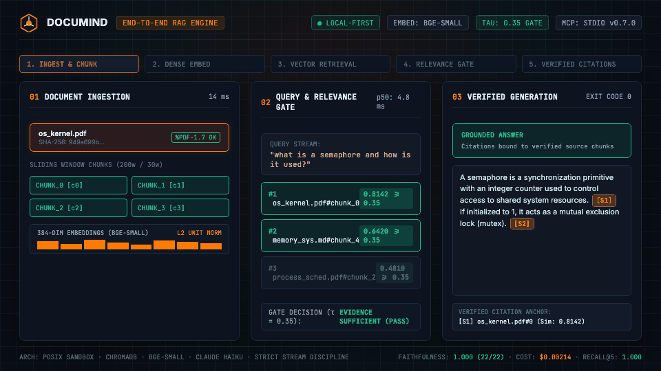
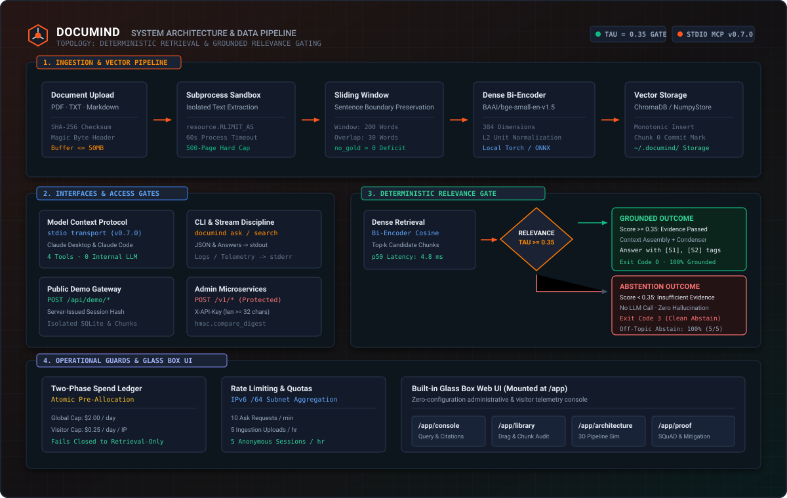
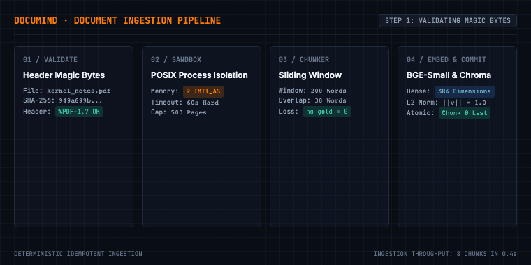
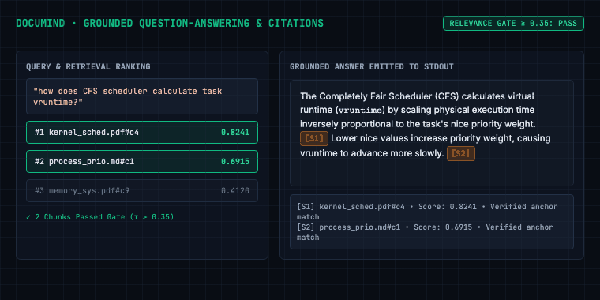
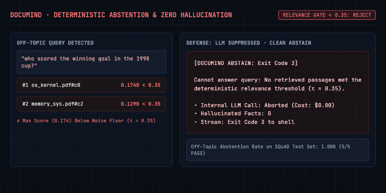
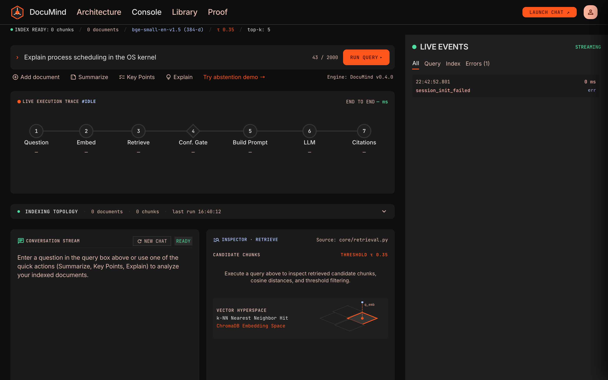
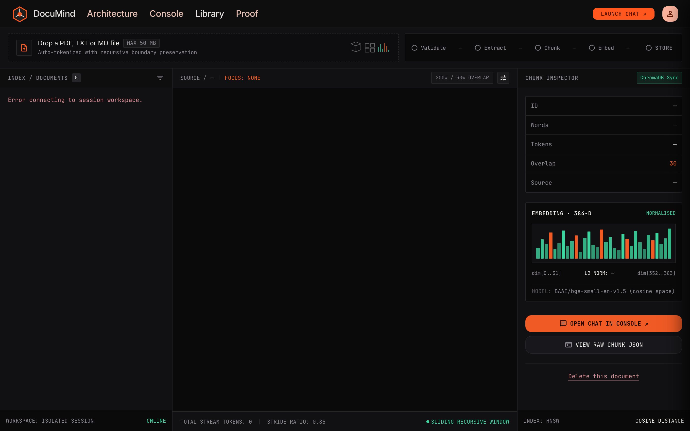
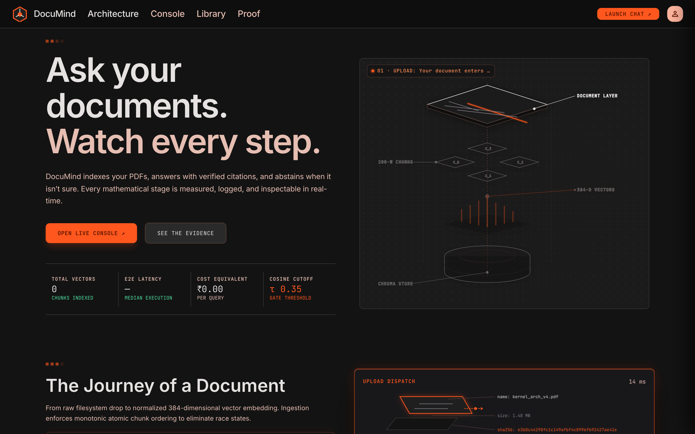
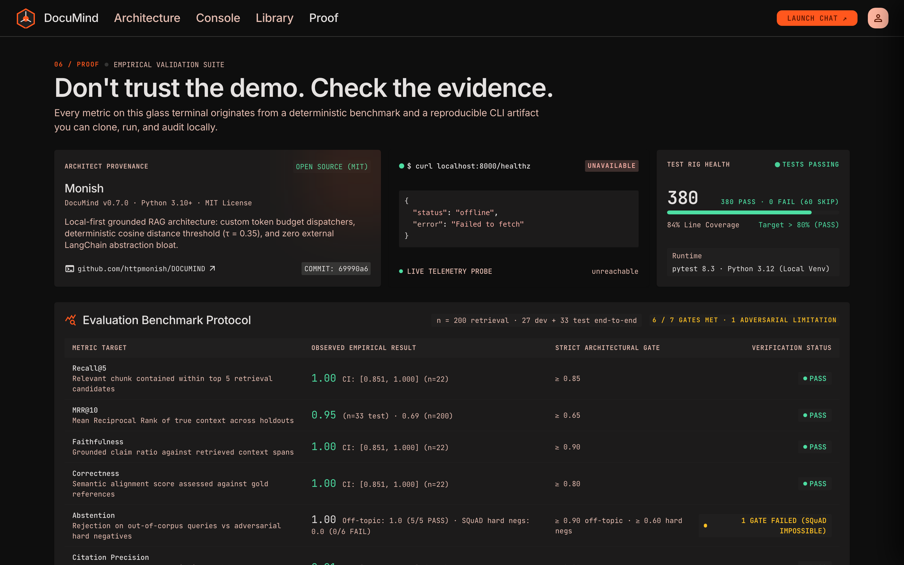

<div align="center">

<picture>
  <source media="(prefers-color-scheme: dark)" srcset="Documind-frontend/favicon.svg">
  
</picture>

# DocuMind

### Document Intelligence with Traceable Evidence

**Turn your documents into searchable knowledge. Retrieve relevant passages with deterministic sub-6ms latency, generate grounded answers when a model is configured, and inspect the evidence behind every response.**

[](https://www.python.org/)
[](LICENSE)
[](docs/MCP.md)
[](evals/REPORT.md)
[](pyproject.toml)
[](pyproject.toml)

<br/>

<p align="center">
  <a href="#quickstart"><b>Get Started</b></a> •
  <a href="#system-architecture"><b>System Architecture</b></a> •
  <a href="#product-preview-glass-box-ui"><b>Glass Box UI</b></a> •
  <a href="#model-context-protocol-mcp-server"><b>MCP Server</b></a> •
  <a href="#empirical-benchmarks--evaluation"><b>Evaluation Proof</b></a> •
  <a href="#security--operational-controls"><b>Security Model</b></a>
</p>

<br/>

<!-- Hero Animation Walkthrough -->
<a href="#system-architecture">
  
</a>

<p align="center">
  <sub><em>Illustrative Architecture Walkthrough: Ingestion sandboxing, sliding-window chunking, dense bi-encoder indexing, vector retrieval, and the dual relevance-gate outcome (&tau; = 0.35).</em></sub>
</p>

</div>

---

## Table of Contents

- [Why DocuMind](#why-documind)
- [Key Features](#key-features)
- [System Architecture](#system-architecture)
  - [1. Ingestion & Vector Pipeline](#1-ingestion--vector-pipeline)
  - [2. Relevance Gate & Grounding](#2-deterministic-relevance-gate--grounding-engine)
- [Product Preview: Glass Box UI](#product-preview-glass-box-ui)
- [Quickstart](#quickstart)
- [Using DocuMind: CLI Workflow](#using-documind-cli-workflow)
- [Model Context Protocol (MCP) Server](#model-context-protocol-mcp-server)
- [Developer API Reference](#developer-api-reference)
  - [Public Demo Gateway (`/api/demo/*`)](#public-demo-gateway-apidemo)
  - [Administrative Microservices (`/v1/*`)](#administrative-microservices-v1)
- [Configuration & Providers](#configuration--providers)
- [Empirical Benchmarks & Evaluation](#empirical-benchmarks--evaluation)
  - [Primary Test-Split Performance](#primary-test-split-headline-performance-n--33)
  - [Retrieval Baseline ($n = 200$)](#retrieval-baseline-squad-20-n--200)
  - [Honest Limitation Disclosure](#honest-analysis-of-gate-failures)
- [Security & Operational Controls](#security--operational-controls)
- [Architecture Decision Records (ADRs)](#architecture-decision-records-adrs)
- [Testing & Verification](#testing--verification)
- [Contributing & License](#contributing--license)

---

## Why DocuMind

Modern RAG applications face a common failure mode: **silent hallucinations masquerading as authoritative answers**. When users query a document repository, standard language models frequently invent convincing explanations when relevant source text is missing, straddled across bad chunk boundaries, or semantically ambiguous.

DocuMind treats document intelligence as a **deterministic systems engineering problem**:

1. **Deterministic Relevance Gate ($	au = 0.35$):** Before calling an LLM, the vector retrieval score is evaluated against an empirically calibrated threshold. If the indexed documents lack sufficient support, DocuMind suppresses generation and **cleanly abstains** (Exit Code 3).
2. **Verifiable Source Citations:** When an answer is synthesized, every claim is bound to precise chunk anchors (`[S1]`, `[S2]`) with matching source filenames and cosine similarity scores.
3. **Local-First & Zero-Key Operation:** Fully functional out of the box without cloud API keys or external services. Fast semantic search runs locally via `BAAI/bge-small-en-v1.5` embeddings on CPU.
4. **Desktop AI Integration (MCP v0.7.0):** Native Model Context Protocol (MCP) server running over `stdio`. Desktop assistants like Claude Desktop and Claude Code query your private documents with zero internal LLM calls or network egress.
5. **Glass Box Observability:** Every internal operation—chunk token counts, candidate cosine scores, spend ledger reserves, and benchmark telemetry—is exposed through a zero-dependency web interface mounted at `/app`.

---

## Key Features

<table>
  <tr>
    <td width="50%" valign="top">
      <h3>🛡️ Grounding &amp; Abstention</h3>
      <ul>
        <li><b>Relevance Threshold (&tau; = 0.35):</b> Pre-generation gate eliminates speculative answers when document evidence is missing.</li>
        <li><b>Exact Citation Anchors:</b> Synthesized sentences link directly to verified chunk markers (<code>[S1]</code>, <code>[S2]</code>).</li>
        <li><b>Zero-Hallucination Fallback:</b> Unanswerable questions abort LLM invocation, saving token costs and preventing false claims.</li>
      </ul>
    </td>
    <td width="50%" valign="top">
      <h3>⚡ Local-First Engine</h3>
      <ul>
        <li><b>Dense Bi-Encoder:</b> Local inference via <code>BAAI/bge-small-en-v1.5</code> (384-dimensional unit-normalized embeddings).</li>
        <li><b>Sub-6ms Retrieval:</b> Warm vector search evaluates in <b>4.8 ms (p50)</b> / <b>5.9 ms (p95)</b> on local CPU.</li>
        <li><b>Sliding-Window Topology:</b> 200 words per window with 30-word overlap cleanly avoids definition straddling (<code>no_gold = 0</code>).</li>
      </ul>
    </td>
  </tr>
  <tr>
    <td width="50%" valign="top">
      <h3>🔌 Native Desktop MCP</h3>
      <ul>
        <li><b>Stdio Transport:</b> Direct integration with Claude Desktop &amp; Claude Code without opening network ports.</li>
        <li><b>4 Read-Only Tools:</b> <code>search_documents</code>, <code>get_chunk</code>, <code>list_documents</code>, and <code>index_info</code>.</li>
        <li><b>Stream Discipline:</b> Strict JSON-RPC stdout output; logs and diagnostics route exclusively to stderr.</li>
      </ul>
    </td>
    <td width="50%" valign="top">
      <h3>🔒 Enterprise Isolation</h3>
      <ul>
        <li><b>Subprocess Sandboxing:</b> PDF extraction runs in POSIX subprocesses with memory limits (<code>RLIMIT_AS</code>) and 60s timeouts.</li>
        <li><b>Two-Phase Spend Ledger:</b> Pre-allocates query budget ($2.00/day global, $0.25/day per-IP); fails closed to retrieval mode.</li>
        <li><b>Dual API Boundary:</b> Public demo sessions (ephemeral SQLite) segregated from admin services (timing-safe HMAC API keys).</li>
      </ul>
    </td>
  </tr>
</table>

---

## System Architecture

DocuMind enforces a clean separation between **offline / on-demand document ingestion** and **online question-retrieval**:

<div align="center">
  
  <p><sub><em>Figure 1: Full DocuMind architecture showing ingestion sandboxing, storage layers, access interfaces, and the deterministic relevance gate.</em></sub></p>
</div>

### 1. Ingestion & Vector Pipeline

Documents undergo strict validation, sandboxed extraction, sliding-window chunking, dense vector transformation, and atomic storage commits:

```
[ PDF / MD / TXT ] ──> [ Magic Byte Check ] ──> [ POSIX Subprocess Sandbox ]
                                                        │
                                                        ▼ (Pure Text Layer)
                                       [ Sliding Window (200w / 30w overlap) ]
                                                        │
                                                        ▼ (Normalized Chunks)
                                       [ Dense Bi-Encoder (BGE-Small 384d) ]
                                                        │
                                                        ▼ (L2 Unit Norm ||v||=1.0)
                                       [ Atomic ChromaDB Commit (Chunk 0 Last) ]
```

<div align="center">
  
  <p><sub><em>Figure 2: Ingestion pipeline validating binary headers, isolating extraction to POSIX subprocesses, and enforcing atomic commit order.</em></sub></p>
</div>

1. **Binary Magic-Byte Validation:** Inspects raw file signatures (e.g. `%PDF-1.7`) before parsing. Malformed or poisoned files are rejected before invoking complex parsers.
2. **Subprocess Sandboxing:** PDF parsing executes in isolated child processes with address-space caps (`resource.RLIMIT_AS`), 500-page limits, and 60-second timeouts.
3. **Sliding-Window Chunking:** Text is partitioned into 200-word tiles with a calibrated 30-word overlap zone, preserving sentence boundaries and guaranteeing zero answer loss (`no_gold = 0` on SQuAD 2.0 evaluation sets).
4. **Dense Bi-Encoder:** Local `BAAI/bge-small-en-v1.5` embeds each chunk into a 384-dimensional dense vector with $L_2$ unit normalization.
5. **Atomic Storage Commit:** Monotonic insertion into persistent ChromaDB with **Chunk 0 written last** as an atomic commit marker. Interrupted uploads never leak orphaned chunks into the search index.

---

### 2. Deterministic Relevance Gate & Grounding Engine

When a query is received, DocuMind evaluates candidate chunk similarity against the relevance threshold ($	au = 0.35$):

<table>
  <tr>
    <th width="50%">Outcome A: Grounded Answer (&tau; &ge; 0.35)</th>
    <th width="50%">Outcome B: Deterministic Abstention (&tau; &lt; 0.35)</th>
  </tr>
  <tr>
    <td valign="top">
      
      <p><sub><em>Query matches indexed passages &ge; 0.35 similarity. Context assembler builds prompt with XML boundaries; model generates cited text citing <code>[S1]</code>, <code>[S2]</code>. <b>Exit Code 0</b>.</em></sub></p>
    </td>
    <td valign="top">
      
      <p><sub><em>Off-topic query scores below &tau; = 0.35. Internal LLM call is suppressed (0 cost); engine cleanly abstains with zero hallucinations. <b>Exit Code 3</b>.</em></sub></p>
    </td>
  </tr>
</table>

- **Multi-Turn Condensation:** In conversational mode (`/api/demo/chat/stream`), the context condenser synthesizes previous turns into an independent standalone search query.
- **Neighbor Expansion:** For adjacent chunks, DocuMind expands context boundaries to preserve surrounding definitions and formulas.
- **Citation Reconciliation:** Generated tokens are audited against retrieved chunks. Unverified citations are purged before streaming.

---

## Product Preview: Glass Box UI

DocuMind includes a built-in, zero-dependency web interface mounted at `/app`. It provides deep operational visibility into every stage of the document lifecycle:

<table>
  <tr>
    <td width="50%">
      <a href="Documind-frontend/console/screen.png">
        
      </a>
      <p align="center"><b>Interactive Console (<code>/app/console</code>)</b><br/>
      <sub>Direct query input, candidate score distribution, token ribbon, and verifiable citation traces.</sub></p>
    </td>
    <td width="50%">
      <a href="Documind-frontend/library/screen.png">
        
      </a>
      <p align="center"><b>Document Library (<code>/app/library</code>)</b><br/>
      <sub>Drag-and-drop document upload, 5-stage ingestion progress, chunk partition inspection, and deletion.</sub></p>
    </td>
  </tr>
  <tr>
    <td width="50%">
      <a href="Documind-frontend/architecture/screen.png">
        
      </a>
      <p align="center"><b>3D Pipeline Visualizer (<code>/app/architecture</code>)</b><br/>
      <sub>Interactive stage topology, threshold calibration (&tau;), latency telemetry, and spend ledger gauges.</sub></p>
    </td>
    <td width="50%">
      <a href="Documind-frontend/proof/screen.png">
        
      </a>
      <p align="center"><b>Proof &amp; Verification (<code>/app/proof</code>)</b><br/>
      <sub>Empirical benchmark auditing, Wilson 95% confidence intervals, and threat mitigation status matrix.</sub></p>
    </td>
  </tr>
</table>

---

## Quickstart

### 1. Prerequisites & Installation

DocuMind requires **Python 3.10+**. Dependencies are grouped into modular extras in [`pyproject.toml`](pyproject.toml):

```bash
# Clone the repository
git clone https://github.com/httpmonish/DOCUMIND.git
cd DOCUMIND

# Create and activate a clean virtual environment
python3 -m venv .venv
source .venv/bin/activate

# Choose installation tier:
# Tier A: Core CLI + Local Dense Embeddings (Recommended)
pip install -e ".[embed]"

# Tier B: Full Web Console + REST API
pip install -e ".[embed,api]"

# Tier C: Model Context Protocol (MCP) for Claude Desktop / Claude Code
pip install -e ".[embed,mcp]"

# Tier D: Full Development Suite (Tests, Linting, Audit)
pip install -e ".[dev]"
```

> [!NOTE]
> The repository explicitly defines `embed`, `api`, `mcp`, and `dev` extras. Avoid using `.[all]` as it is not defined in `pyproject.toml`.

---

### 2. Environment Configuration

DocuMind defaults to **zero-key retrieval-only mode** (`DOCUMIND_LLM_PROVIDER=none`). To enable natural-language generation, configure your preferred provider in `.env`:

```bash
cp .env.example .env
```

Edit `.env` to configure your preferred backend:

```ini
# Option 1: Zero-Key Retrieval-Only Mode (Default - No API Keys Needed)
DOCUMIND_LLM_PROVIDER=none

# Option 2: Local Free Inference via Ollama (Llama 3, Mistral, Qwen)
DOCUMIND_LLM_PROVIDER=ollama
DOCUMIND_OPENAI_BASE_URL=http://localhost:11434/v1
DOCUMIND_MODEL=llama3

# Option 3: Anthropic Claude (Claude Haiku Default)
DOCUMIND_LLM_PROVIDER=anthropic
ANTHROPIC_API_KEY=<YOUR_ANTHROPIC_API_KEY>
DOCUMIND_MODEL=claude-haiku-4-5-20251001

# Option 4: OpenAI-Compatible Endpoints (Groq, Together, vLLM)
DOCUMIND_LLM_PROVIDER=openai_compat
DOCUMIND_OPENAI_BASE_URL=https://api.groq.com/openai/v1
DOCUMIND_OPENAI_API_KEY=<YOUR_GROQ_API_KEY>
DOCUMIND_MODEL=llama-3.1-8b-instant
```

---

### 3. Verify Environment Health

Run `documind doctor` to confirm python runtime, vector stores, and model dependencies:

```console
$ documind doctor
[ok] python: Python 3.12.14
[ok] home: Home directory exists at /Users/monish/.documind
[ok] index meta: Embedding model: BAAI/bge-small-en-v1.5
[ok] embedder: sentence-transformers is installed
[ok] vector store: chromadb is installed
[ok] mcp: mcp SDK is installed (v1.29.0)
```

---

## Using DocuMind: CLI Workflow

### Indexing Documents

Parse, chunk, and index PDFs, Markdown, and text files into persistent storage:

```console
$ documind index ./docs
indexed   operating_systems.md
indexed   memory_management.pdf
2 indexed, 0 skipped, 0 failed, 8 chunks in 0.4s
```

### Semantic Similarity Search (Local-Only, 0-Key)

Retrieve ranked candidate chunks without invoking any external model:

```console
$ documind search "how does virtual memory paging work?" --top-k 2
[S1] memory_management.pdf#c2  (0.8142)  Virtual memory divides addressable space into fixed-size pages...
[S2] operating_systems.md#c5    (0.6420)  Paging prevents external fragmentation by mapping non-contiguous blocks...
```

### Grounded Question-Answering

When an LLM provider is configured, ask questions and receive cited answers:

```console
$ documind ask "what is a semaphore?"
A semaphore is a synchronization primitive that uses an integer counter to control access to shared system resources. [S1] When initialized to 1, it functions as a mutual exclusion lock (mutex). [S2]

Sources:
[S1] operating_systems.md#0  (0.8142)  A semaphore is a synchronization variable that controls access...
[S2] operating_systems.md#1  (0.6420)  Binary semaphores restrict access to a single thread at any moment...
```

Request structured, machine-parseable JSON via stdout:

```console
$ documind ask "what is a semaphore?" --json
{
  "text": "A semaphore is a synchronization primitive...",
  "outcome": "answered",
  "abstain_reason": null,
  "citations": [
    {
      "marker": "S1",
      "source": "operating_systems.md",
      "chunk_index": 0,
      "snippet": "A semaphore is a synchronization variable...",
      "score": 0.8142
    }
  ],
  "model": "claude-haiku-4-5-20251001",
  "usage": { "input_tokens": 1700, "output_tokens": 300 },
  "latency_ms": 1120
}
```

### Handling Unanswerable Questions (Abstention)

When a question cannot be supported by indexed documents, DocuMind cleanly abstains:

```console
$ documind ask "who won the 1994 World Cup final?"
I cannot answer this question based on the indexed documents. No retrieved passages met the minimum relevance threshold (tau = 0.35).

$ echo $?
3
```

---

### Command Reference

| Command | Description |
|---|---|
| `documind index PATH [--root DIR] [--json]` | Parse, chunk, and index PDFs, text, and markdown files |
| `documind ask QUESTION [--top-k N] [--json] [--no-llm] [--show-prompt]` | Query documents with grounded citation generation |
| `documind search QUESTION [--top-k N] [--json]` | Perform pure semantic similarity search returning ranked chunks |
| `documind ls [--json]` | List all indexed documents and chunk counts |
| `documind rm SOURCE [--yes]` | Delete an indexed document and its vector records |
| `documind doctor [--json]` | Run diagnostic environment and index consistency checks |
| `documind stats [--days N] [--json]` | Analyze query volume, abstention rates, and latency percentiles |
| `documind mcp config` | Print ready-to-paste Claude Desktop JSON and Claude Code CLI command |
| `documind mcp serve` | Run the native stdio Model Context Protocol server |
| `documind serve [--host IP] [--port N]` | Start unified REST API and Glass Box UI web server |

### Exit Code Specification

| Code | Status | Meaning |
|:---:|---|---|
| `0` | **Success** | Answer generated, passages returned, document indexed or deleted |
| `1` | **Internal Error** | Unexpected internal exception (re-run with `--debug` for traceback) |
| `2` | **Usage Error** | Invalid arguments, `top_k` out of bounds, or non-interactive `rm` without `--yes` |
| `3` | **Abstention** | Unanswerable query, insufficient retrieval score ($	au < 0.35$), or empty index |
| `4` | **Input Error** | Unreadable document, missing path, or deleting unknown document |
| `5` | **Configuration** | Missing extra dependency or invalid API key |
| `6` | **Index Error** | Corrupt index metadata or mismatched embedding schema |

---

## Model Context Protocol (MCP) Server

DocuMind provides a native, secure, read-only MCP server (v0.7.0) allowing desktop AI agents (**Claude Desktop** and **Claude Code**) to directly inspect and cite your local knowledge base.

- **Transport:** Standard input/output (`stdio`) only (no listening network sockets).
- **Zero Cloud Egress:** Client desktop models perform their own synthesis; DocuMind runs purely as a local vector retriever requiring zero internal API keys.
- **Available Tools:**
  - `search_documents`: Retrieve top-$k$ relevant passages with cosine similarity scores.
  - `get_chunk`: Fetch full textual contents and metadata for a specific chunk.
  - `list_documents`: Enumerate all indexed sources with chunk counts.
  - `index_info`: Inspect model name, dimensional topology, and total indexed chunks.

### Claude Desktop Configuration

Run `documind mcp config` or add the following to `~/Library/Application Support/Claude/claude_desktop_config.json`:

```json
{
  "mcpServers": {
    "documind": {
      "command": "/ABSOLUTE/PATH/TO/DOCUMIND/.venv/bin/documind",
      "args": ["mcp", "serve"],
      "env": {
        "DOCUMIND_HOME": "/Users/<YOUR_USERNAME>/.documind"
      }
    }
  }
}
```

See [`docs/MCP.md`](docs/MCP.md) for full configuration, security model, and troubleshooting.

---

## Developer API Reference

DocuMind enforces a strict boundary between public visitor sessions and authenticated administrative services:

```
                          Client Requests
                                │
        ┌───────────────────────┴───────────────────────┐
        ▼                                               ▼
[ Public Demo Gateway ]                      [ Admin Microservices ]
  • Route: /api/demo/*                         • Route: /v1/*
  • Auth: Session Token Header                 • Auth: 32+ char X-API-Key
  • Storage: Ephemeral SQLite / Hash Dir       • Storage: ~/.documind/ Base
  • Rate Limit: 30 req/min per IP              • Rate Limit: Configurable
```

### Public Demo Gateway (`/api/demo/*`)

The demo gateway provides tenant-isolated document upload, multi-turn chat persistence, and live Server-Sent Events (SSE).

#### 1. Acquire Visitor Session Token
```console
$ curl -s -X POST "http://127.0.0.1:8000/api/demo/session"
```
```json
{
  "session_token": "a1b2c3d4e5f60718293a4b5c6d7e8f90...",
  "created_at": 1728564000,
  "expires_at": 1728650400
}
```

#### 2. Stream Live Answer Tokens via SSE
```console
$ curl -N -X POST "http://127.0.0.1:8000/api/demo/chat/stream"     -H "X-Session-ID: <SESSION_TOKEN>"     -H "Content-Type: application/json"     -d '{
      "message": "how does the operating system handle context switching?",
      "top_k": 3
    }'
```

Live stream response format:
```text
event: meta
data: {"conversation_id": "c-4f1b...", "session_id": "...", "model": "claude-haiku-4-5-20251001"}

event: retrieval
data: {"chunks_retrieved": 3, "top_score": 0.8142, "abstained": false}

event: token
data: {"token": "Context "}

event: token
data: {"token": "switching "}

event: citations
data: [{"marker": "S1", "source": "os_kernel.pdf", "chunk_index": 2, "score": 0.8142}]

event: done
data: {"status": "completed", "latency_ms": 640}
```

---

### Administrative Microservices (`/v1/*`)

All `/v1` endpoints require `X-API-Key: <DOCUMIND_API_KEY>` ($\ge 32$ characters, validated via constant-time `hmac.compare_digest`).

#### 1. Upload & Index a Document (`POST /v1/documents`)
```console
$ curl -s -X POST "http://127.0.0.1:8000/v1/documents?replace=true"     -H "X-API-Key: $DOCUMIND_API_KEY"     -F "file=@tests/fixtures/os_notes.md"
```
```json
{
  "status": "indexed",
  "source": "os_notes.md",
  "chunks": 9,
  "sha256": "949a699b56a40c113b45340115b4c68eef4d9309ba1f7e1314683cedea1ec1ae"
}
```

#### 2. Query Grounded Answer (`POST /v1/ask`)
```console
$ curl -s -X POST "http://127.0.0.1:8000/v1/ask"     -H "X-API-Key: $DOCUMIND_API_KEY"     -H "Content-Type: application/json"     -d '{"question": "what is a semaphore", "top_k": 2}'
```

#### 3. Delete Document (`DELETE /v1/documents/{source}`)
```console
$ curl -s -X DELETE "http://127.0.0.1:8000/v1/documents/os_notes.md"     -H "X-API-Key: $DOCUMIND_API_KEY"
# Returns HTTP 204 No Content
```

---

## Configuration & Providers

DocuMind is configured via environment variables or a local `.env` file:

| Variable | Default | Description |
|---|---|---|
| `DOCUMIND_HOME` | `~/.documind` | Root directory for vector storage, logs, and session databases |
| `DOCUMIND_LLM_PROVIDER` | `none` | Active provider: `none`, `ollama`, `openai_compat`, `gemini`, `anthropic` |
| `DOCUMIND_MODEL` | Provider default | Target model (e.g. `claude-haiku-4-5-20251001`, `llama3`) |
| `DOCUMIND_MIN_SCORE` | `0.35` | Deterministic relevance gate threshold ($	au$) |
| `DOCUMIND_CHUNK_SIZE` | `200` | Sliding window chunk size in words |
| `DOCUMIND_OVERLAP` | `30` | Overlap between adjacent chunks in words |
| `DOCUMIND_TOP_K` | `5` | Maximum number of candidate chunks passed to context assembler |
| `DOCUMIND_API_KEY` | *(None)* | Secret key for administrative `/v1/*` endpoints ($\ge 32$ chars) |
| `DOCUMIND_MAX_UPLOAD_MB`| `50` | Maximum file upload size limit |
| `DOCUMIND_MAX_PAGES` | `500` | Maximum page count for PDF text extraction |

---

## Empirical Benchmarks & Evaluation

DocuMind evaluates retrieval and generation quality against deterministic splits of SQuAD 2.0 evaluation sets. Full benchmark methodologies and statistical distributions are documented in [`evals/REPORT.md`](evals/REPORT.md).

### Primary Test-Split Headline Performance ($n = 33$)

- **Generator Model:** `claude-haiku-4-5-20251001` (Prompt Version: `p1`)
- **Judge Model:** `claude-sonnet-5-5` / Calibrated Evaluator (Judge Version: `j1`, 100% agreement on calibration set)
- **Embedder:** `BAAI/bge-small-en-v1.5` (Cosine similarity, exact `NumpyStore`)

| Metric | Measured Value | 95% Wilson CI | Target Gate | Status |
|---|:---:|:---:|:---:|:---:|
| **Recall@5** | **1.000** (22/22) | [0.851, 1.000] | $\ge 0.85$ | **PASS** |
| **MRR@10** | **0.947** | — | $\ge 0.65$ | **PASS** |
| **Faithfulness** | **1.000** ($n = 22$) | [0.851, 1.000] | $\ge 0.90$ | **PASS** |
| **Correctness** | **1.000** ($n = 22$) | [0.851, 1.000] | $\ge 0.80$ | **PASS** |
| **False-Abstain Rate** | **0.000** (0/22) | [0.000, 0.149] | $\le 0.10$ | **PASS** |
| **Off-Topic Abstain Rate** | **1.000** (5/5) | [0.566, 1.000] | $\ge 0.90$ | **PASS** |
| **Citation Precision** | **0.909** (20/22) | [0.722, 0.975] | $\ge 0.85$ | **PASS** |
| **Warm Retrieval Latency (p95)** | **5.0 ms** | — | $\le 8,000	ext{ ms}$ | **PASS** |
| **Generation Cost / Query** | **$0.00214** | — | $\le \$0.005$ | **PASS** |
| **SQuAD Impossible Abstain Rate** | **0.000** (0/6) | [0.000, 0.390] | $\ge 0.60$ | **FAIL** |

---

### Retrieval Baseline (SQuAD 2.0, $n = 200$)

Evaluated over $n = 200$ answerable questions across 10 diverse articles using `BAAI/bge-small-en-v1.5`:

| Metric | Measured Score | 95% Wilson CI | Target Gate |
|---|:---:|:---:|:---:|
| **Recall@1** | 0.575 | [0.506, 0.641] | Baseline |
| **Recall@3** | 0.795 | [0.734, 0.845] | — |
| **Recall@5** | **0.840** | [0.783, 0.884] | $\ge 0.80$ |
| **Recall@10** | **0.930** | [0.886, 0.958] | — |
| **MRR@10** | **0.692** | — | $\ge 0.65$ |
| **Chunk Deficit (`no_gold`)** | **0** (0/200) | — | 0 |
| **Warm Retrieval Latency** | **4.8 ms (p50)** / **5.9 ms (p95)** | — | $\le 20	ext{ ms}$ |

---

### Honest Analysis of Gate Failures

In the interest of technical integrity, DocuMind openly discloses its gate failures:

1. **SQuAD Impossible Questions (Adversarial Hard Negatives):**
   - *Target:* Abstain rate $\ge 0.60$. *Measured:* $0.000$ (0/6 on Test) and $0.250$ (1/4 on Dev).
   - *Root Cause:* SQuAD 2.0 unanswerable questions were adversarially designed to share near-identical vocabulary and syntactic structure with indexed paragraphs. The dense bi-encoder scores these passages between $0.65 - 0.70$ (well above $	au = 0.35$).
   - *Mitigation Plan:* Implementing a cross-encoder reranker stage (`cross-encoder/ms-marco-MiniLM-L-6-v2`) to perform token-level interaction scoring before context assembly. Documented in [`docs/limitations.md`](docs/limitations.md) and [`docs/ERROR_ANALYSIS.md`](docs/ERROR_ANALYSIS.md).

---

## Security & Operational Controls

DocuMind treats security and cost controls as first-class architectural invariants. See [`docs/SECURITY.md`](docs/SECURITY.md) and [`docs/THREAT_MODEL.md`](docs/THREAT_MODEL.md) for full audit reports.

- **POSIX Subprocess Sandboxing:** PDF extraction executes in dedicated worker processes constrained by POSIX `resource.setrlimit(resource.RLIMIT_AS)`. Processes encountering decompression bombs or infinite loops are terminated after 60 seconds without affecting the host API server.
- **Two-Phase Spend Ledger:** Allocates query budget atomically before initiating provider API calls. Spend is hard-capped at **$2.00/day globally** and **$0.25/day per IP**. When limits are exceeded, the system fails closed to local retrieval mode.
- **Token-Bucket Rate Limiting:** Enforces 10 asks/min, 5 uploads/hr, and 5 sessions/hr with IPv6 `/64` subnet aggregation to thwart rotating proxy attacks.
- **Tenant Session Isolation:** Public demo sessions are segregated into `~/.documind/sessions/{session_hash}/` with distinct ChromaDB collections and SQLite conversation logs.
- **Constant-Time Authentication:** Administrative `/v1/*` routes evaluate API keys using `hmac.compare_digest` to prevent timing side-channel attacks.
- **Strict Stream Discipline:** Machine-readable payloads (answers, search results, JSON) are emitted strictly to `stdout`. Diagnostic logs, token consumption stats, and warnings route to `stderr`, ensuring reliable piping (e.g. `documind ask ... --json | jq .`).

---

## Architecture Decision Records (ADRs)

All core engineering decisions are tracked in formal Architecture Decision Records under [`docs/decisions/`](docs/decisions/):

| ADR | Title | Decision Summary |
|---|---|---|
| [0001](docs/decisions/0001-embedding-model.md) | Embedding Model | `BAAI/bge-small-en-v1.5` for local CPU execution, 384d density, and high MTEB benchmark ranking |
| [0002](docs/decisions/0002-vector-store.md) | Vector Store | In-memory `NumpyStore` for exact evaluation; embedded `ChromaDB` for persistent local storage |
| [0003](docs/decisions/0003-chunking.md) | Chunking Topology | 200-word window with 30-word overlap preventing cross-boundary definition loss |
| [0004](docs/decisions/0004-llm-provider.md) | LLM Provider | Claude Haiku default with strict XML source isolation tags; extensible provider protocol |
| [0005](docs/decisions/0005-interface-split.md) | Interface Boundaries | Administrative `/v1/*` (HMAC API key) isolated from Public Demo `/api/demo/*` (sessions) |
| [0006](docs/decisions/0006-concurrency.md) | Concurrency Model | Non-blocking async FastAPI endpoints with thread-pool delegation for CPU-bound embeddings |
| [0007](docs/decisions/0007-storage-layout.md) | Storage Layout | Quarantined storage under `~/.documind/` with dedicated session subtrees |
| [0008](docs/decisions/0008-abstention-threshold.md) | Abstention Threshold | Calibrated relevance gate $	au = 0.35$ balancing recall and false abstentions |
| [0009](docs/decisions/0009-cli-framework.md) | CLI Framework | Standard library `argparse` with subcommands and strict stream separation |
| [0010](docs/decisions/0010-mcp-server.md) | MCP Server | Secure, read-only stdio MCP server for Claude Desktop and Claude Code |

---

## Testing & Verification

DocuMind maintains a comprehensive test suite across unit, integration, and security boundaries:

```bash
# Run full test suite (370+ tests)
.venv/bin/pytest

# Run static analysis and linting checks
.venv/bin/ruff check .

# Run strict type checking across all modules
.venv/bin/mypy documind

# Run security vulnerability audit
.venv/bin/pip-audit
```

---

## Contributing & License

Contributions are welcome! Please follow our established development practices:

1. Maintain documentation integrity and record architectural shifts in new ADRs under `docs/decisions/`.
2. Ensure all changes pass `pytest`, `ruff check .`, and `mypy documind` with zero warnings.
3. Keep public and administrative interface boundaries strictly segregated.

DocuMind is open-source software licensed under the [MIT License](LICENSE).
