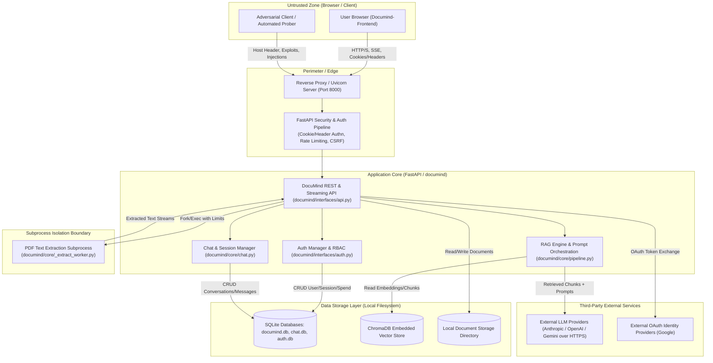

# DocuMind Comprehensive Threat Model (STRIDE)

**Document Version:** 1.0.0  
**Phase:** S0 - Threat Model & Baseline Assessment  
**Evaluation Standard:** Microsoft STRIDE, OWASP Top 10 (2021), OWASP Top 10 for LLM Applications (2025)  
**System Classification:** Local-First / Multi-Tenant Retrieval-Augmented Generation (RAG) System  
**Status:** Baseline Established (Pre-Hardening)

---

## 1. Executive Summary & Purpose

DocuMind is an AI-powered document intelligence and RAG platform. It allows users to upload structured and unstructured documents (PDFs, Markdown, plain text), indexes content into embedded vector and relational storage (ChromaDB and SQLite), and enables conversational question-answering with citations via external Large Language Model APIs (Anthropic Claude, OpenAI, Google Gemini).

The objective of this Threat Model is to establish a rigorous, adversarial-first security blueprint. In alignment with our core security posture:
- **Every upload, filename, query string, chat payload, and HTTP header is treated as fully attacker-controlled.**
- **No component is considered implicitly trusted.**
- **Defense-in-depth is enforced at browser, transport, application, operating system subprocess, data store, and LLM boundaries.**

---

## 2. System Architecture & Data Flow



---

## 3. Assets Inventory & Criticality

| Asset ID | Asset Description | Confidentiality | Integrity | Availability | Impact if Compromised |
|:---|:---|:---:|:---:|:---:|:---|
| **AST-01** | **User Documents & Uploads** (Raw PDFs, MDs, TXTs) | High | High | High | Data breach of confidential corporate or personal documents. |
| **AST-02** | **Extracted Chunks & Vector Embeddings** (ChromaDB) | High | High | Medium | Unauthorized semantic search, cross-tenant data leakage. |
| **AST-03** | **User Credentials & Auth Secrets** (Passwords, hashes, session tokens) | High | High | High | Complete account takeover, identity spoofing, session hijacking. |
| **AST-04** | **Provider API Keys** (`ANTHROPIC_API_KEY`, `OPENAI_API_KEY`) | Critical | High | High | Financial theft, quota exhaustion, third-party LLM account misuse. |
| **AST-05** | **Spend Ledgers & Rate Limit Quotas** (SQLite) | Medium | High | High | Financial denial-of-service, runaway model query billing. |
| **AST-06** | **Conversation History & Citations** | High | Medium | Medium | User privacy violations, hallucinated citation tampering. |
| **AST-07** | **Host Server & Filesystem Integrity** | Critical | Critical | Critical | Arbitrary code execution (RCE), host compromise, lateral movement. |

---

## 4. Trust Boundaries

```
[Browser / Public Internet]
------------------------ Trust Boundary 1: Transport & Network ------------------------
[Uvicorn / Reverse Proxy / FastAPI Endpoints]
------------------------ Trust Boundary 2: Tenant & Session Separation -----------------
[Application Logic: User A vs User B vs Guest Session]
------------------------ Trust Boundary 3: Ingestion Worker Sandbox -------------------
[PDF Parsing Subprocess (pypdf / _extract_worker.py)]
------------------------ Trust Boundary 4: Local Persistence Boundary ------------------
[Local Disk: SQLite, ChromaDB, File Upload Store, .env]
------------------------ Trust Boundary 5: External LLM & OAuth Boundary --------------
[External APIs: Anthropic, Google OAuth, OpenAI]
```

### Trust Boundary Details:
1. **TB-1 (Browser / Internet to FastAPI):** No input from the client is trusted. All headers (`Host`, `Origin`, `Cookie`, `Authorization`), bodies, file multipart payloads, and query parameters are untrusted.
2. **TB-2 (Tenant Isolation):** Multiple users (and anonymous guest sessions) utilize the same server instance. User A must never access, search, modify, or delete User B's documents, conversations, or chunks (IDOR).
3. **TB-3 (Document Extraction Sandbox):** Untrusted binary files (PDFs, crafted markdown) parsed by third-party parsers (`pypdf`) must run under strict isolation (memory caps, page limits, timeout, dropped capabilities) to prevent parser exploits from compromising the main server.
4. **TB-4 (Data Persistence):** SQL queries and vector store collections must maintain parameterized bounds and user ownership constraints.
5. **TB-5 (LLM Communication):** Document chunks provided to the LLM must be treated as untrusted data, never instructions. Model output returned to the application must be treated as untrusted content before presenting to the browser.

---

## 5. Threat Actors & Capabilities

| Threat Actor | Motivation | Access Level | Capabilities |
|:---|:---|:---|:---|
| **TA-1: Anonymous Internet Attacker** | Opportunistic exploitation, automated vandalism, botnet recruitment | Network access to public HTTP port (8000) | Port scanning, path traversal probes, DDoS, credential stuffing, malformed header injection. |
| **TA-2: Malicious Registered Tenant** | Industrial espionage, privilege escalation, resource exhaustion | Valid user account or guest session | IDOR parameter manipulation, prompt injection via uploaded documents, Cross-Site Scripting (XSS), token spend drain. |
| **TA-3: Adversarial Content Creator** | Indirect prompt injection, malware distribution | Indirect via files uploaded by victims | Crafting weaponized PDFs, polyglot files, hidden Unicode prompt override attacks, SSRF payload links. |
| **TA-4: Man-in-the-Middle (MITM)** | Session hijacking, eavesdropping on corporate queries | Intercepting unencrypted transit | Sniffing plaintext cookies, intercepting unencrypted HTTP traffic, stripping headers. |
| **TA-5: Compromised Supply Chain** | Backdoor injection, arbitrary code execution | Upstream package repositories (PyPI, npm, Hugging Face) | Poisoned dependencies, malicious model weights (pickle deserialization), typo-squatted libraries. |

---

## 6. Comprehensive STRIDE Threat Analysis

### 6.1. Spoofing (S)

| Threat ID | Threat Description | Attack Vector | Baseline Vulnerability Assessment | Target Mitigation Phase |
|:---|:---|:---|:---|:---:|
| **S-01** | **Session Hijacking via Stolen Token** | Script reads session token from `localStorage` or unhardened cookies. | Current frontend stores session tokens in browser `localStorage`, accessible to any XSS payload. | **S1, S2** |
| **S-02** | **Host Header Injection / Cache Poisoning** | Attacker sends arbitrary `Host` or `X-Forwarded-Host` headers to manipulate redirects or password reset links. | Baseline app lacks strict `TrustedHostMiddleware` enforcement. | **S1, S5** |
| **S-03** | **Guest Account Claiming Spoofing** | Attacker claims another user's guest documents during registration/login. | Document migration logic must strictly verify ownership before rebinding owner IDs. | **S2** |
| **S-04** | **Credential Brute Force / Account Impersonation** | Automated credential stuffing attacks against `/api/auth/login`. | In-memory throttling lacks persistent lockout across IP/account pairs and allows timing attacks. | **S2** |

### 6.2. Tampering (T)

| Threat ID | Threat Description | Attack Vector | Baseline Vulnerability Assessment | Target Mitigation Phase |
|:---|:---|:---|:---|:---:|
| **T-01** | **Indirect Prompt Injection** | Weaponized PDF/Markdown contains instructions overriding system prompt ("Ignore previous instructions..."). | Partially mitigated by XML wrapping in Phase 5, but vulnerable to tag breakout, unicode obfuscation, and multi-turn manipulation. | **S4** |
| **T-02** | **Cross-Site Request Forgery (CSRF)** | Malicious third-party website submits forged state-changing requests (e.g., delete document, post chat). | Streaming endpoints and POST requests do not consistently enforce CSRF tokens across all routes. | **S2** |
| **T-03** | **Document & Metadata Tampering** | Manipulating filename, mime type, or document ID to overwrite existing files on disk. | Filename sanitization exists, but file overwrites and polyglot validation require magic byte verification. | **S3** |
| **T-04** | **Model Output Tampering (Hallucinated Citations)** | LLM generates fabricated citation markers `[S99]` pointing to nonexistent sources. | Citations must be strictly validated against retrieved chunk IDs. | **S4** |

### 6.3. Repudiation (R)

| Threat ID | Threat Description | Attack Vector | Baseline Vulnerability Assessment | Target Mitigation Phase |
|:---|:---|:---|:---|:---:|
| **R-01** | **Unlogged Authentication Events** | Attacker brute-forces accounts or deletes documents without audit trail. | Security events are not emitted as structured, append-only security logs. | **S7** |
| **R-02** | **Document Deletion Without Trace** | Rogue tenant deletes critical documents; no audit log records timestamp or actor. | Hard deletes occur in SQLite and vector store without security audit entries. | **S7** |

### 6.4. Information Disclosure (I)

| Threat ID | Threat Description | Attack Vector | Baseline Vulnerability Assessment | Target Mitigation Phase |
|:---|:---|:---|:---|:---:|
| **I-01** | **Cross-Tenant IDOR (Insecure Direct Object Reference)** | User A queries `/v1/documents/{id}` or retrieves chunks belonging to User B. | Endpoints must enforce multi-tenant filter at every database query and ChromaDB query layer. | **S2, S4** |
| **I-02** | **Cross-Site Scripting (XSS)** | Malicious file name (``) or injected model output rendered via `innerHTML`. | Frontend uses innerHTML in multiple UI components (`app.js`, `api.js`, `auth.html`). | **S1** |
| **I-03** | **Sensitive Data in Application Logs** | Full document text, user queries, or API keys printed to stdout/stderr. | Logs require strict redaction filters to prevent token and PII leakage. | **S4, S7** |
| **I-04** | **Debug Mode Leakage & Stack Traces** | Production errors display full stack traces, environment variables, or database paths. | FastAPI defaults to standard exception handling unless production error interceptors are active. | **S5** |
| **I-05** | **Data Exfiltration via Markdown Images/Links** | Injected document causes model to render ``. | Model output is rendered as markdown without stripping external image/link tags. | **S1, S4** |

### 6.5. Denial of Service (DoS)

| Threat ID | Threat Description | Attack Vector | Baseline Vulnerability Assessment | Target Mitigation Phase |
|:---|:---|:---|:---|:---:|
| **DoS-01** | **Decompression Bomb / Malformed PDF Hang** | Attacker uploads nested zip/PDF decompression bomb or deeply nested objects causing worker CPU/memory freeze. | Subprocess worker has 60s timeout, but lacks seccomp, strict RLIMIT_NPROC/FSIZE, or process group tree kill. | **S3** |
| **DoS-02** | **Token Spend Quota Exhaustion** | Attacker floods `/v1/chat` with massive queries to exhaust the Anthropic/OpenAI budget. | In-memory token bucket can be bypassed by restarting process or distributing IPs. Requires persistent SQLite spend ledger. | **S4** |
| **DoS-03** | **Unbounded Embedding Concurrency** | Flooding simultaneous upload requests exhausts server memory and worker threads. | Missing global concurrency semaphore on embedding tasks. | **S4** |
| **DoS-04** | **Large Payload Memory Exhaustion** | Sending gigabyte multipart payloads to exhaust memory before reaching disk. | Streaming byte counter exists for uploads, but general request body size limits are unconfigured. | **S3, S5** |

### 6.6. Elevation of Privilege (EoP)

| Threat ID | Threat Description | Attack Vector | Baseline Vulnerability Assessment | Target Mitigation Phase |
|:---|:---|:---|:---|:---:|
| **EoP-01** | **Extractor Worker Sandbox Escape** | Exploit in `pypdf` gains code execution and accesses host filesystem (`.env`, `documind.db`). | Worker runs with standard user privileges, network access enabled, and full read access to workspace. | **S3** |
| **EoP-02** | **Admin /v1 API Misuse** | Legacy or development admin endpoints reachable without strict role separation or rotation. | Admin API enabled without multi-key support or production disablement switch. | **S2** |
| **EoP-03** | **Arbitrary Code Execution via Deserialization** | Model weights or vector index files loaded using `pickle` or `torch.load`. | Codebase uses standard libraries, but model checkpoints and embeddings must be pinned to safe formats (`safetensors`, `trust_remote_code=False`). | **S6** |

---

## 7. OWASP Top 10 for LLM Applications (2025) Mapping

| OWASP LLM ID | Vulnerability Category | Specific Threat in DocuMind | Countermeasure Strategy |
|:---|:---|:---|:---|
| **LLM01** | **Prompt Injection** | Indirect injection via uploaded documents attempting to alter system prompt. | Boundary tags, tag neutralizing, canary tokens, documents treated as data only, expanded 60+ injection test suite. |
| **LLM02** | **Insecure Output Handling** | Model output rendered directly into browser DOM executing JavaScript or exfiltrating data. | Plaintext DOM rendering, strict CSP, stripping URLs/HTML/images from model completions. |
| **LLM05** | **Supply Chain Vulnerabilities** | Poisoned dependencies in Python packages or compromised Hugging Face models. | Pinned dependency hashes (`pip-compile`), pinned model revisions, `trust_remote_code=False`. |
| **LLM08** | **Excessive Agency** | LLM granted access to tools or administrative functions. | Model has zero tools and zero access to server execution. Read-only context query. |
| **LLM10** | **Unbounded Consumption** | Excessive prompt length or continuous querying causing massive token charges. | Strict token and character caps per turn, global kill switch, persistent spend ledger. |

---

## 8. Residual Risk Register (Baseline Assessment)

> [!WARNING]
> Security is an ongoing process of defense-in-depth and risk reduction. The system will **never be claimed unconditionally "secure"**. Below is the frank, honest accounting of baseline residual risks prior to the execution of phases S1–S7.

1. **Client-Side Token Exposure:** Current frontend components rely on script-accessible tokens in `localStorage`, making sessions vulnerable if any XSS flaw exists.
2. **Subprocess Isolation Gaps:** The PDF extraction worker runs under standard user permissions without OS-level namespace/seccomp sandboxing or network denial.
3. **In-Memory Rate Limiting:** Current spend and rate limiting trackers do not survive process restarts, allowing determined adversaries to cycle process states to bypass limits.
4. **Third-Party Model Dependency:** DocuMind relies on external LLM APIs (Anthropic, OpenAI). No prompt filtering can guarantee 100% defense against all semantic prompt injections without limiting model expressiveness.
5. **ChromaDB Upstream Advisories:** ChromaDB 1.5.9 has known CVEs in its HTTP server components. While DocuMind utilizes embedded storage only, upstream dependency vulnerabilities remain until patched upstream.
